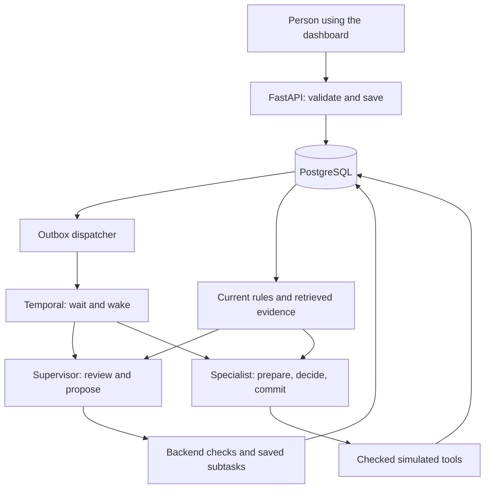

# How the platform works

Checked against the code on 14 November 2026.

The system keeps a job alive without keeping an AI conversation running all day.
**PostgreSQL remembers the work. Temporal remembers when to wake it. An agent works
for a short turn, saves its result and stops.**

## The main parts

| Part | Job |
|---|---|
| Dashboard and FastAPI | Let a person assign work, inspect it and supply updates |
| PostgreSQL | Store tasks, plans, rules, original evidence and execution history |
| Outbox and inbox | Save outgoing start/wake requests and incoming events so crashes do not lose them |
| Temporal workflows | Wait for dates or events, retry work and recover after restarts |
| Case supervisor | Review one case objective and propose permitted records assignments |
| Specialist runtime | Load context, run a bounded agent turn, check actions and save the result |
| Domain adapters | Define each specialist's tools, state and completion requirements |
| Memory and retrieval | Load current controls and find supporting historical evidence |

These are parts of one Python application. The API and worker are separate processes;
PostgreSQL and Temporal run alongside them. Each row does not represent a separate service.

## Follow one job

A person assigns "collect Ravi's records" through the shared task form. The
supervisor receives approved provider/document targets. It checks existing tasks,
then proposes any missing records assignments. The backend validates the scope,
reuses covering work and rejects overlapping requests before saving new subtasks.
Each executable subtask gets its own workflow and can wait independently.

A specialist activation has three steps:

1. **Prepare:** load the pinned agent definition, current domain state, applicable
   rules, new events and supporting history. Save that starting context.
2. **Decide:** run the model or scripted equivalent. Tools check scope, versions,
   contact holds and duplicate-action keys before a simulated action.
3. **Commit:** recheck versions and current memory, verify evidence, then save
   progress and events. Relevant outcomes wake the supervisor.

No database lock spans a model call. If information changes while the agent is
thinking, its decision can be rejected as stale and retried with fresh context.
Saved tool results protect retries from repeating simulated effects. The full
intermediate reasoning of the model is not checkpointed.

A task normally moves through `PENDING`, `RUNNING`, `WAITING`, `BLOCKED` and
`COMPLETED`. Exhausted retries can produce `FAILED`. `CANCELLED` is supported as a
terminal state, but there is no general operator takeover/cancellation product flow.
Group tasks organize work; they are not specialist executions.

## Records and check-ins

**Records v3** sends an initial simulated request and up to three due-checked
reminders. Completion requires saved evidence for every required item and no open
obligations. Missing evidence or exhausted follow-up policy requires human help.
Records v2 remains executable without reminders; v1 is analysis-only. New supervisor
v2 objectives delegate records v3. Existing work retains its pinned definitions.

**Client check-ins** send at a scheduled time and accept one attributed reply per
task. Saved self-reports are compared with the previous report. Configured demo
rules flag changes or concerns; they are not clinical assessments. Flagged reports
require an explicit teammate decision before completion.

**Recurring series** are assigned by a person. A series workflow creates one
check-in task at a time and waits for its completion before starting the next
interval. Open replies/reviews prevent overlap. Pause blocks unsent outreach;
stop is final and cancels an unsent child. Sent work can still finish. Series have
an end bound and a hard cap of 100 occurrences; failed/cancelled children pause them.

**Monthly calendars** wake the supervisor through its durable inbox. The coordinator
uses deterministic rules for this explicitly approved cadence, reuses pending work,
checks recent sends/replies and current holds, then creates a check-in task or records
a skip/block. This does not change published records-only model definitions or enable
arbitrary free-text check-in planning. Each schedule/month has a unique occurrence.

The shared contact check serializes sends and rechecks spacing at action time.
Manual check-ins count; open replies/reviews prevent overlap. Missed dates do not
create catch-up bursts. See [monthly check-ins](monthly-check-ins.md) for the full policy.

## Current controls and historical evidence

Every activation gets applicable firm/provider instructions, effective open holds
and obligations. SQL loads these directly; they do not depend on a similarity search.
Resolved, superseded and retired items stay out of current controls. Only optional
notes can expire. Review dates never lift holds. The indexing worker also processes
scheduled lifecycle transitions; action-time checks independently enforce dates.

Original evidence and searchable passages remain available through `retrieve_context`
and `read_evidence`. Historical text cannot grant permission or prove completion.
See [memory and retrieval](memory-and-retrieval.md) and [memory lifecycle](memory-lifecycle.md).

The supervisor loads at most 200 task summaries and 100 inbox events per activation;
an incomplete task overview requests review. Mandatory memory is loaded separately
and is not silently cut to those limits. Oversized essential context requests help.
