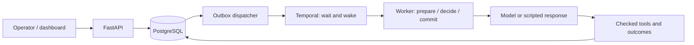

# Agents platform — simple high-level design

## 1. The idea

**PostgreSQL remembers the work. Temporal remembers when to wake it. An agent runs a short turn, saves its result and stops.**

An assignment may last months; a model call lasts seconds. The application keeps the
assignment alive through saved state, timers and events. It does not keep one AI
conversation running continuously.

This is a working demo. Outreach and document receipt are simulated. Scripted
responses and real model calls use the same tools and backend validation.

## 2. The architecture

This is one Python application. The API and worker run as separate processes,
next to PostgreSQL and Temporal. The diagram does not represent microservices.

| Part | Responsibility |
|---|---|
| Dashboard + API | Assign work, supply updates and record human decisions |
| PostgreSQL | Store business facts, evidence, current rules and execution history |
| Temporal | Persist timers, wake workflows and retry activities across restarts |
| Runtime | Load context, run a bounded agent turn and validate its outcome |
| Domain adapter | Supply a use case's state, tools and completion checks |
| Supervisor | Discover registered capabilities, delegate durable child tasks and monitor updates |
| Memory/retrieval | Load current controls and find historical evidence |
| Operations/telemetry | Expose failures, delays and unresolved work with correlated logs |

## 3. What is saved?

| Object | Meaning |
|---|---|
| Task | The assignment: objective, case, status and pinned agent version |
| Execution | One activation's saved context, result, attempts and usage |
| ToolInvocation | An action result and a logical key preventing duplicate effects |
| Source / RecordEvidence | Original information and links to the requirements it satisfies |
| ActivityEvent | A recorded business change |
| Inbox / Outbox | Unprocessed incoming events / undelivered start-or-wake requests |
| HumanRequest / HumanDecision | A question for a person and their attributed response |
| HumanContinuation | One authorized follow-up with exact dates |
| ExecutionIncident | Failed execution needing an operator's recovery decision |
| ManualContact | An attributed account of contact outside the app |

**One task can have many executions.** Group tasks organize work; they do not run specialists.
Business rows hold current state; events retain history. This is not full event sourcing.

## 4. Follow one job

1. **Assign:** validate the case, people, scope and published agent. Save the task,
   business request, event and outbox message together.
2. **Dispatch:** deliver the saved start/wake request to Temporal. Failed delivery
   leaves the message available for retry.
3. **Prepare:** load current state, active rules, new events and relevant history.
   Save the context and expected task version.
4. **Decide:** the model selects tools and proposes a next step. Tools independently
   check scope, restrictions, due times and duplicate-action keys.
5. **Commit:** recheck versions and rules, verify evidence, then save progress and events.
   Evidence IDs exposed by adapters are case-checked. Invalid model proposals receive
   bounded correction feedback; rejected output remains available for inspection.
6. **Wait or finish:** Temporal sleeps until a date/signal or ends the workflow.

A wake signal says “check your inbox.” The saved event carries the business facts.
Approved schedules and human continuations can advance through deterministic code
without spending a model call.

No database lock spans a model call. If facts change during reasoning, the old
proposal can be discarded and replanned. The full model reasoning is not checkpointed. The automatic polling budget resets
when new business information arrives; it does not limit total task lifetime.

Typical states: `PENDING → RUNNING → WAITING / BLOCKED / COMPLETED`.
Exhausted retries produce `FAILED`; explicit stopping can produce `CANCELLED`.

## 5. How the use cases differ

**Records:** each requirement has a document type and date scope. Bills can arrive
without records or imaging. Every follow-up requests only currently missing items.
Completion requires saved evidence for every required item and no open obligations.
Records v3 permits three automatic reminders; a person can explicitly authorize one
additional attempt. Case state and participant roles are rechecked before contact.

**Client check-ins:** send once, accept one attributed reply, compare structured
self-report fields with the previous report, and require review for configured concerns.
Self-reports remain unverified. Raw narrative understanding is not established by
labelled model evaluations.

**Schedules:** interval series wait for completion before the next delay. Monthly
calendars retain calendar dates, use unique occurrences and skip missed slots.
Pending interactions and contact-spacing checks prevent overlapping outreach.

**Coordination:** supervisor intake interprets a description into a reviewable plan
for records, one-off check-ins, monthly calendars or interval series. Approval
atomically records the approved assignments. Supervisor v3 also discovers developer-registered
capabilities and generates typed delegation tools for new domains. Approved hospital targets
retain their evidence and overlap checks; calendar delegation remains deterministic. New
specialists run as durable child tasks. See `adding-agents.md` and `supervisor-intake.md`.

## 6. Human intervention and recovery

A business blocker creates a request showing the question, evidence and permitted
decisions. The backend validates the person's response and wakes the same task.
Resolving one request does not clear other restrictions or missing evidence.

A manual call stores the contact, actual time, outcome and operator notes. It does
not create documents, clear holds or count as a client reply. Reached client contact
contributes to the configured spacing policy; voicemail does not.

An execution incident represents exhausted technical retries. Recovery retains the
business task, evidence and action keys, but starts a new Temporal workflow identity,
execution generation and fresh context. Late old-generation work cannot mutate it.
The demo allows three operator recoveries. A person can also cancel the assignment.

## 7. Important decisions and implications

| Decision | Why | Implication |
|---|---|---|
| Separate business state from orchestration | Facts and timers have different jobs | PostgreSQL and Temporal need a reliable bridge |
| Save inbox/outbox records | A crash must not lose a wake-up | Delivery may repeat; processing must be idempotent |
| Model proposes; backend enforces | Model confidence is not permission or proof | Domain checks belong in trusted code |
| Keep logical action keys across retries | The same send must not happen twice | Recovery reuses saved results |
| Recheck state before actions and commit | Humans and providers update facts concurrently | Stale model work may be discarded |
| Load active controls through SQL | Search must never hide a contact hold | Oversized mandatory context needs human help |
| Retrieve history as evidence | Months of history cannot fit every model call | Historical text cannot grant permission |
| Pin published agent definitions | Existing work should not change silently | New behavior needs a new version and explicit adoption |
| Separate adapters from runtime | Reuse execution safeguards across domains | Each domain still supplies intake, tools and completion rules |
| Separate reviews from incidents | A missing authorization differs from a broken model call | Operators receive different recovery options |

Duplicate protection covers transactional **simulated effects**. It does not prove
exactly-once delivery for future email/phone integrations. Unknown external delivery
must be reconciled before retry; blind retry is blocked today.

## 8. Extend, learn and explain

To add insurance claim-status follow-up: define typed input and evidence, implement
an adapter, register/publish its definition, add intake and human-response handling,
and test waiting, updates, retries and completion. Export its `AgentCapability` from a
module in `agent_plugins/`; `expose_to_supervisor` defaults to true. Discovery supplies
the supervisor and assignment planner with the capability and generates its typed
delegation tool. No supervisor-specific dispatch branch is required. See
[Adding agents](adding-agents.md) for the registration, deployment and versioning contract.

Read the code in this order:

1. `models.py`, `task_contracts.py` — saved objects and accepted inputs.
2. `tasks.py`, `task_api.py` — assignment and evidence intake.
3. `dispatch.py`, `orchestration/workflows.py` — durable waiting and delivery.
4. `execution.py`, `domains.py` — prepare, decide and commit.
5. Domain adapters, human-request handlers and `recovery.py` — business differences.
6. Memory, coordination, scheduling and operations modules — context and oversight.

Ask at every step: **What is saved? Who may change it? What if this runs twice?
What if new facts arrive before it finishes?**

The demo uses shared development credentials and Temporal's development server.
Real integrations, individual authorization, evidence correction and scale testing
remain unfinished. Backend tests establish execution mechanics; model judgment and
browser journeys need separate evaluation. The old inline CLI is a scaffold; the
API, database, outbox, Temporal and worker form the durable product path.
