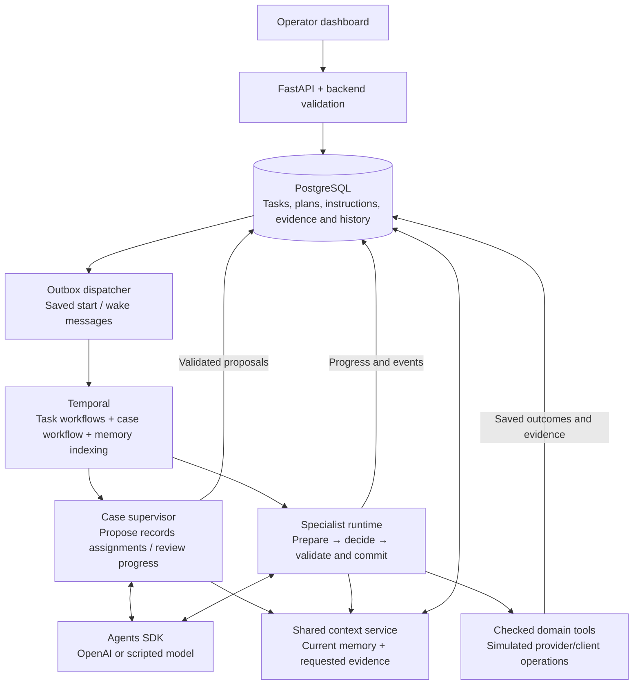

# Architecture

Reviewed against the code on 14 November 2026.

The platform keeps work alive without keeping an agent process running. PostgreSQL holds the responsibility and progress. Temporal decides when to run again. An agent runs one bounded activation, uses checked tools, saves a result, then exits.

## Layers

These are logical components in one Python codebase. FastAPI serves the dashboard and API; a worker process runs activities and dispatch. PostgreSQL and a local Temporal development server run alongside them. The diagram does not imply one service per box.

| Layer | Job | Why it exists |
|---|---|---|
| Dashboard/API | Accept assignments and operator changes; validate case/contact scope | People need to inspect work and supply controlled guidance |
| PostgreSQL | Save tasks, case plans, sources, instructions, memory and execution history | Business state outlives any model call |
| Outbox/inbox | Save outgoing dispatch intent and pending incoming events | A crash must not lose an assignment or wake-up; delivery can safely repeat |
| Temporal | Run activities, sleep for timers/signals, retry and recover | Waiting does not require a running agent conversation |
| Agent runtime | Load context, run the SDK, validate results and save progress | Reasoning and enforced business rules have separate responsibilities |
| Domain adapter | Own a specialist's input, tools, state and completion rules | Records and check-ins reuse the execution lifecycle |
| Memory/context | Load mandatory state and retrieve selected evidence | Agents need current rules plus relevant history, not every past message |

## Task and execution

A **task** is a saved responsibility with a case, objective, status, progress and published agent version. A **group task** organizes child work; it has no specialist workflow. An **execution** is one activation of an executable task. Its starting context, agent definition hash, attempt, decision, tools, outcome and usage are inspectable.

An executable task moves from `PENDING` to `RUNNING`, then usually to `WAITING`, `BLOCKED` or `COMPLETED`. Timers or new information can resume waiting/blocked work. Exhausted automatic retries can produce `FAILED`. `CANCELLED` is a recognized terminal state; a formal operator cancellation/takeover flow is not implemented.

The specialist activation has three steps:

1. **Prepare:** load the pinned definition, domain state, mandatory memory and relevant events; save the starting snapshot.
2. **Decide:** run a bounded SDK activation. Domain tools check scope, permission, current state and duplicate keys before a simulated effect. Read-only context tools fetch supporting evidence.
3. **Commit:** recheck task version and mandatory-memory fingerprint, validate citations and domain evidence, then save the outcome and events.

No database lock spans a model call. A new update can invalidate an in-flight decision; that execution is marked stale and work continues from fresh state. Retries reuse saved starting context and completed tool results. Full intermediate model reasoning is not checkpointed.

Task workflows interpret shared outcomes. Model/database/tool work stays inside activities. Temporal manages execution progression; PostgreSQL remains the source of business state. The [memory guide](memory-and-retrieval.md) explains the model-facing context budget.

## Case supervisor

One case coordinator saves an objective, approved records targets, a revision, plan and unresolved review questions. Its case workflow wakes on relevant assignments, operator guidance and material specialist outcomes, rather than every tool event.

The model proposes records assignments or review questions. Backend code validates participants and current task versions, reuses covering work, rejects duplicate/overlapping outreach, and starts independent specialist workflows. The supervisor can propose that a records objective is satisfied only when backend evidence checks support it. That does not close the legal case.

Automatic records delegation currently supports the published medical-records specialist. Client check-ins are assigned by an operator. Their meaningful updates enter case coordination. A check-in creates a monitoring coordinator when none exists; it does not replace an existing records objective. Monitoring-only coordination handles those events deterministically without an extra model call.

The records supervisor overview is limited to 200 tasks and 100 inbox events per activation. An incomplete task overview requests review. Plans and automatic decisions have limits; identical unresolved reviews are deduplicated. Replacing an objective requires its current revision and does not cancel old specialist work.

## The two workflows

### Medical-records collection

1. An operator or supervisor assigns a patient/provider and required record types/date scope.
2. Task, request, requirements, event and dispatch intent are saved together.
3. The specialist sends one simulated initial request, checks status, and waits.
4. A timer or simulated provider update starts another activation. A `RECEIVED` update creates clearly labelled synthetic record sources.
5. Completion requires saved evidence for every required item. Open obligations prevent completion. Repeatedly proposing a wait on an unsent draft triggers bounded replanning, then review.
6. Completion/blocker/failure events notify the case supervisor.

Medical-records v2 is executable; v1 remains analysis-only and is not silently upgraded. Creation/update keys protect against duplicate requests, not arbitrary real-world delivery uncertainty.

### Client check-in

Each task represents one scheduled simulated message and one attributed client reply. Temporal waits until the scheduled time without an early model/tool call. The send uses a stable logical key. The next check-in is another explicitly scheduled task, not an automatic recurring series.

Reply intake preserves the original message and structured self-report, links the previous report for the same client/case, and compares them using `client-change-rules.v1`:

- A first report establishes a baseline. A pain-score difference of at least two, function changes, treatment updates, changed concerns or help requests are surfaced.
- Worsening function, a pain increase of at least two, a score of eight or more, a concern or help request requires teammate review.
- A changed narrative without a classified structured change is also surfaced for review. Unchanged routine reports without a review trigger avoid a new material-update notification; persistent concerns or high/worsening symptoms can still be surfaced.

These are demo rules, not clinical findings. Missing values mean “not reported.” The specialist summarizes supplied evidence; backend checks prevent completion without a reply or when review is required. Whole-case contact holds apply; provider-only holds do not become client-wide restrictions.

## Human involvement and boundaries

Operators can comment, explicitly wake work, add/resolve typed memory items, publish instruction revisions, submit provider/client updates and revise objectives. A plain comment does not wake a specialist; an explicit wake does. Supervisor mentions wake a configured coordinator.

Resolving a memory item records a reason and can resume work. It is not the full approve/reject/takeover workflow. Review questions are persisted, but guidance does not count as approval. External content remains evidence, even after being stored or retrieved.

All outreach and received records are simulated. The development operator credential can access multiple firms; scoped queries and database relationships do not replace production user permissions. Remaining work is listed once in the [roadmap](roadmap.md).
